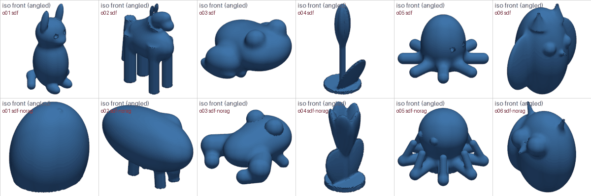
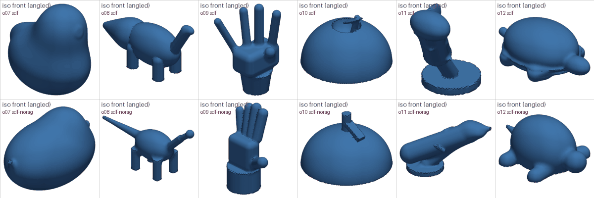

# Organic shapes with SDF modeling (#42, 2026-10-28)

Question: can the agent build organic objects (animals, plants, figurines) itself, by writing signed distance
function (SDF) scripts (`stl_agent/sdf.py`), instead of downloading them from Thingiverse?

**Answer: mostly yes, but crudely.** With the SDF examples, gemini-3.5-flash-lite sculpts 9 of 12 cases into a
valid part. The visual judge passes 8 of 12 (mean score 0.57), against 9 of 12 for Thingiverse's first
download (mean 0.49).
- The scores are close, but they hide a difference in kind:
  - Sculpted parts are recognisable blob figures that always show the requested object.
  - A Thingiverse model is detailed when the search finds the right thing, and unrelated when it doesn't (a
    rose for "tulip", a fruit-fly trap for "apple").
- So `organic_builder` stays `thingiverse` by default. Sculpting is an option for when there is no
  Thingiverse token, no matching model, or a combined part needs a piece at a known size and pose.

## Setup
- **Cases:** `eval/organic_cases.json`, 12 organic requests written like the gate's `organic_spec` (what the
  object looks like, overall size). None is an object in the SDF example library (a test checks).
- **Model:** gemini-3.5-flash-lite, max 4 attempts, `size_feedback = "measured"`; one run per case.
- **Configs:**
  - `sdf`: SDF script, 3 retrieved SDF examples (library lib11-5cd03c).
  - `sdf-norag`: SDF script, no examples. The system prompt still lists the whole API.
  - `thingiverse`: the first model that downloads for the case's `search` words, unscaled (no LLM requests).
- **Judge:** gemini-3.1-flash-lite, prompt v2, renders v2, the same judge model as every other study here, for
  all 36 parts. It sees the request, the measured size and six views, and passes a part at a score of 0.5 or
  more.

## Build results
| config | built (valid mesh) | best effort | first try | requests |
|---|---|---|---|---|
| sdf | 9 / 12 | 3 (o04, o05, o12) | 0 | 36 |
| sdf-norag | 10 / 12 | 2 (o09, o10) | 0 | 33 |
| thingiverse | 9 / 12 watertight | 3 not watertight (o04, o05, o08) | – | 0 |

- **No case passed on the first attempt.** Almost every first attempt failed the size check against the
  model's own BBOX line: organic sizes are hard to estimate from blended shapes. The size message from #23
  usually fixed it in one repair.
- **The other main failure was separate bodies** (2–3 disconnected pieces): a part placed so it doesn't touch
  the rest. Without examples, there were also more script errors (5 against 1).

## Judge results (all 12 cases)
| config | pass | mean score | match | minor | feature wrong | different object |
|---|---|---|---|---|---|---|
| sdf | 8 / 12 | 0.57 | 2 | 4 | 4 | 2 |
| sdf-norag | 7 / 12 | 0.49 | 2 | 3 | 4 | 3 |
| thingiverse | 9 / 12 | 0.49 | 0 | 5 | 4 | 3 |

| case | sdf | sdf-norag | thingiverse |
|---|---|---|---|
| o01 cat | 0.56 | 0.00 | 0.67 |
| o02 horse | 0.44 | 0.00 | 0.56 |
| o03 frog | 0.89 | 0.89 | 0.78 |
| o04 tulip | 0.67 | 0.56 | 0.00 (a rose) |
| o05 octopus | 0.56 | 0.89 | 0.67 |
| o06 owl | 0.89 | 0.78 | 0.56 |
| o07 rubber duck | 0.78 | 0.00 | 0.56 |
| o08 brontosaurus | 0.44 | 0.78 | 0.78 |
| o09 hand | 0.22 | 0.56 | 0.67 |
| o10 apple | 0.67 | 0.33 | 0.00 (a fruit-fly trap) |
| o11 dolphin | 0.00 | 0.33 | 0.56 |
| o12 turtle | 0.78 | 0.78 | 0.11 (a "squishy turtle" dome toy) |

Renders of the downloaded Thingiverse models are not committed: they are other people's models, many licensed
non-commercial and/or no-derivatives (`judge run` recreates them locally from `outputs/bench/`). Licenses of
the 12 downloads: 4 CC BY-SA, 3 CC BY-NC-ND, 2 CC BY-NC-SA, 1 CC BY-NC, 1 CC BY, 1 public domain.

## Findings
- **Examples help, mostly by preventing blobs.**
  - Without them, three parts were featureless egg shapes scored 0 (cat, horse, rubber duck): the main body
    covered every other feature.
  - With examples, that never happened, but one part got an example's features (the cat has the rabbit's long
    ears, #29).
  - On cases where both built a recognisable object, neither is consistently better (the octopus, brontosaurus
    and hand scored higher without examples).
- **Our prompt cut both apples in half.** The rule "let the lowest parts sink a little below z = 0, then cut
  everything below" was followed with the apple's centre at z = 0, so the cut removed the bottom half (judge:
  "hemispherical"). The rule should say to lift the object to rest on z = 0 first, so the cut trims only a few
  mm. This is our instruction misleading the model, so it is a prompt fix, not a model limit.
- **Thin, articulated shapes are the weak spot:** the hand (boxy palm, three fingers and a thumb) and the dolphin
  (no tapering, fins missing). Blends of a few primitives can't give a dolphin's tapered body without many more
  parts.
- **Thingiverse quality depends on the search finding the object.** Three of 12 downloads were the wrong thing
  (rose, fruit-fly trap, a dome toy). A name/tag check (#39) would catch the first two. The judge also docks
  every download for size, since downloads come at their original scale; the app scales pieces of combined
  parts.
- **The judge is generous to crude shapes** that have the listed features (0.89 for blob frogs and owls) and
  harsh on details like finger counts. Its scores rank the three configs close together, while to the eye a
  correct Thingiverse download is far more detailed than any sculpted part.

## After the flat-base fix (#47, 2026-10-28)
The prompt now ends every script with `result = shape.on_ground()`, which measures the lowest point, lifts the
shape to 1.5 mm below z = 0 and trims there; the SDF examples use it too (library lib11-69660d). Same model,
attempts, judge, prompt v2 and renders v2; one run per case. Rows record the SDF prompt version
(`lib11-69660d+sdfp-a4ea4e`, `norag+sdfp-a4ea4e`). 67 build requests, 24 judge requests.

| config | built | pass | mean score |
|---|---|---|---|
| sdf, before | 9 / 12 | 8 / 12 | 0.57 |
| sdf, after | 11 / 12 | 10 / 12 | 0.70 |
| sdf-norag, before | 10 / 12 | 7 / 12 | 0.49 |
| sdf-norag, after | 8 / 12 | 6 / 12 | 0.51 |

| case | sdf before | sdf after | sdf-norag before | sdf-norag after |
|---|---|---|---|---|
| o01 cat | 0.56 | 0.44 | 0.00 | 0.11 |
| o02 horse | 0.44 | 0.44 | 0.00 | 0.00 |
| o03 frog | 0.89 | 1.00 | 0.89 | 0.89 |
| o04 tulip | 0.67 | 0.78 | 0.56 | 0.56 |
| o05 octopus | 0.56 | 0.78 | 0.89 | 1.00 |
| o06 owl | 0.89 | 0.78 | 0.78 | 0.89 |
| o07 rubber duck | 0.78 | 0.78 | 0.00 | 0.33 |
| o08 brontosaurus | 0.44 | 0.89 | 0.78 | 0.11 |
| o09 hand | 0.22 | 0.67 | 0.56 | 0.44 |
| o10 apple | 0.67 | 0.78 | 0.33 | 1.00 |
| o11 dolphin | 0.00 | 0.56 | 0.33 | 0.22 |
| o12 turtle | 0.78 | 0.56 | 0.78 | 0.56 |

- **Both apples are whole now** (round body with a small flat footprint, stem and leaf); before, both were
  hemispheres. The no-examples apple went from 0.33 to 1.00. The sdf apple's 0.78 is for a dimple the model
  modelled into the bottom, not a cut.
- **Overall: better with examples, unchanged without.** With examples, built 9 → 11 and pass 8 → 10. Without, the
  totals moved by one or two parts in each direction, and the per-case swings (brontosaurus 0.78 → 0.11, apple
  0.33 → 1.00) are the run-to-run noise noted below, not the rule: only the apples were affected by the cut.
- **No new failure from the helper:** no script misused `on_ground` or still cut at z = 0 by hand.

## Next
- Repeat runs (one run per case is noisy; most per-case differences above are within that noise).
- Disconnected parts are the most common build failure. The repair message could say which parts float, using
  the mesh's bodies.
